# CalculatriceWS – Service Web SOAP avec Jakarta XML Web Services

TP2 – Architecture SOA et services web | LSI3-GLSI
Faculté des Sciences de Sfax | Année universitaire 2026-2027
*Réalisé par : Hamdi Ahmed*

---

## 1. Description

CalculatriceWS est une application Java qui expose un service web SOAP de calculatrice. Elle propose quatre opérations : somme, soustraction, multiplication et division.

Le service est développé avec Jakarta XML Web Services (JAX-WS), géré par Maven, publié avec Endpoint.publish et testé avec SoapUI.

### Activité 1 : Projet Maven

Fichier pom.xml

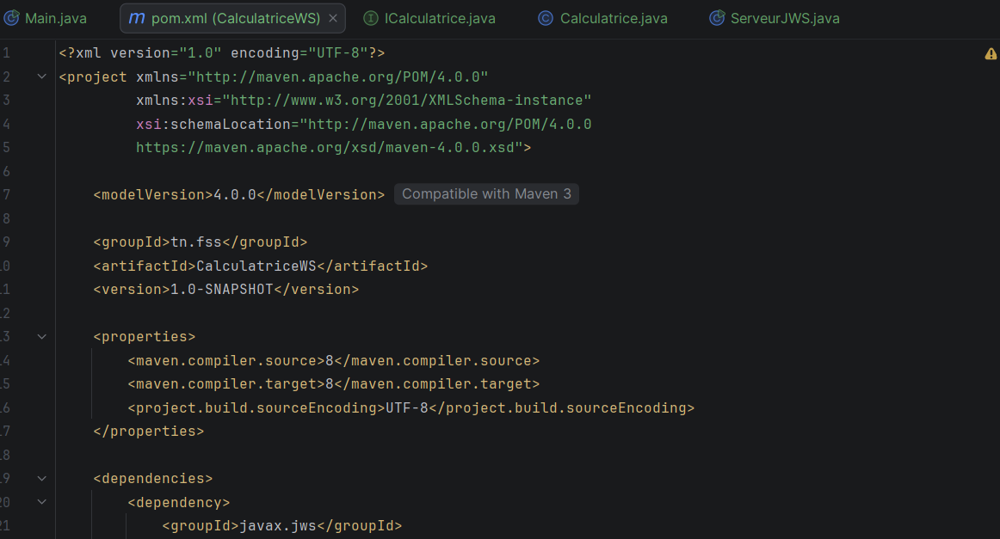

### Activités 2 et 3 : Interface, classe métier et annotations

*Interface ICalculatrice*

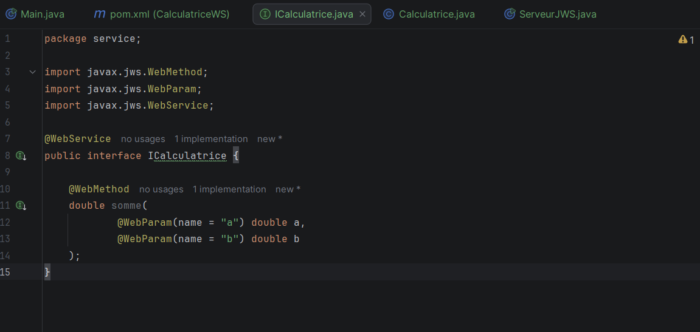

*Classe Calculatrice*

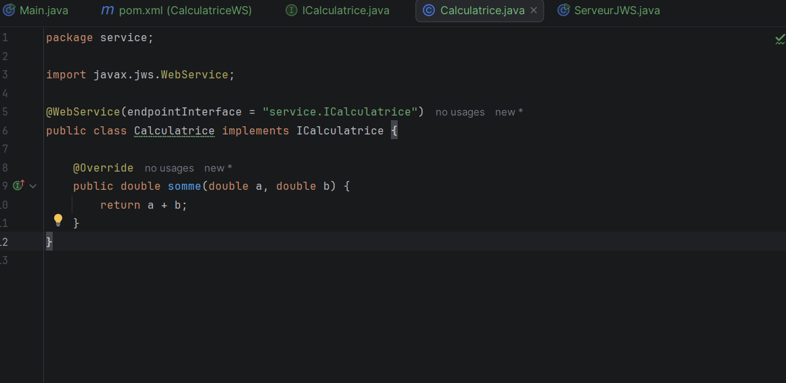

### Activité 4 : Publication du service

*Classe ServeurJWS*

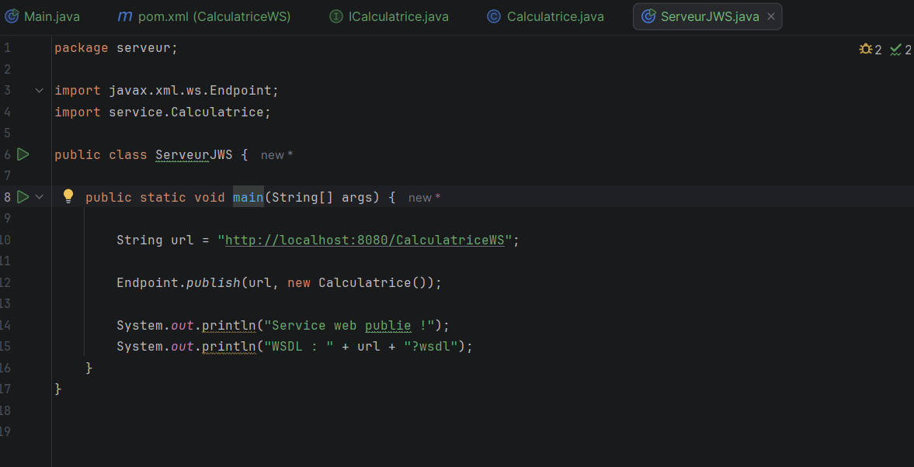

Console du serveur

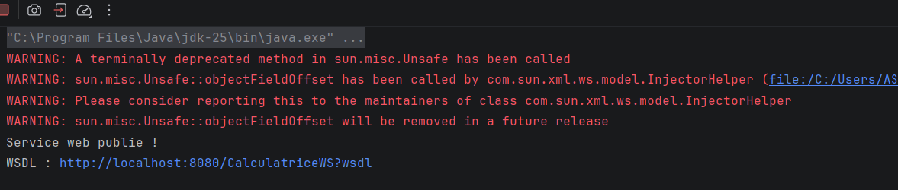

voici url : http://localhost:8080/CalculatriceWS?wsdl

WSDL généré

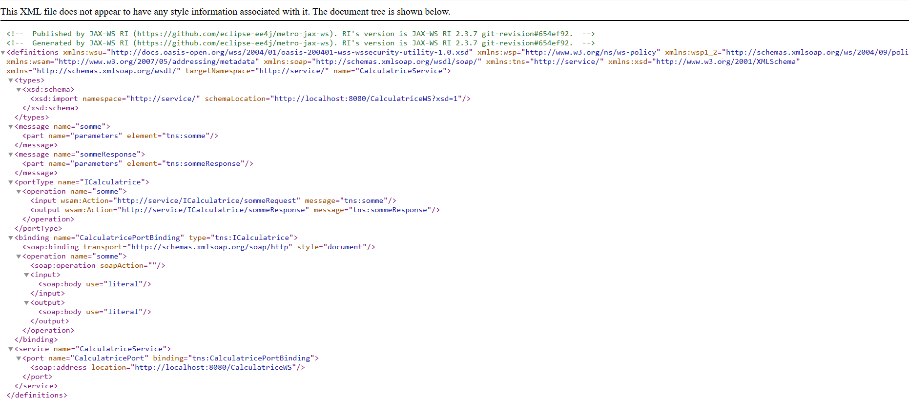

### Activité 5 : Tests avec SoapUI

Création du projet SoapUI

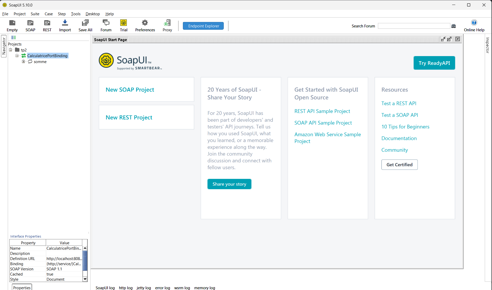

Opérations importées

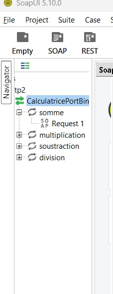

*Opération somme*

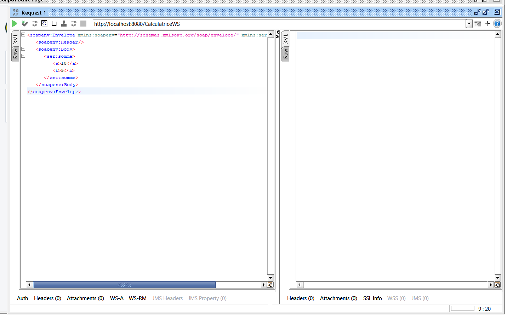
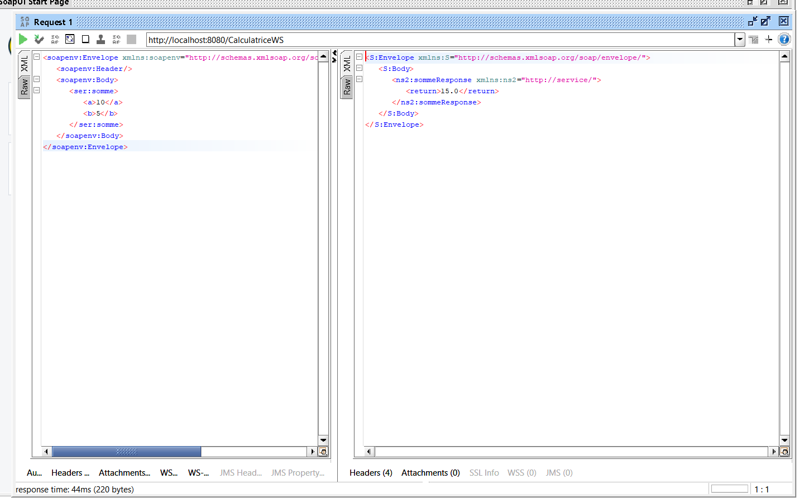
*Opération soustraction*

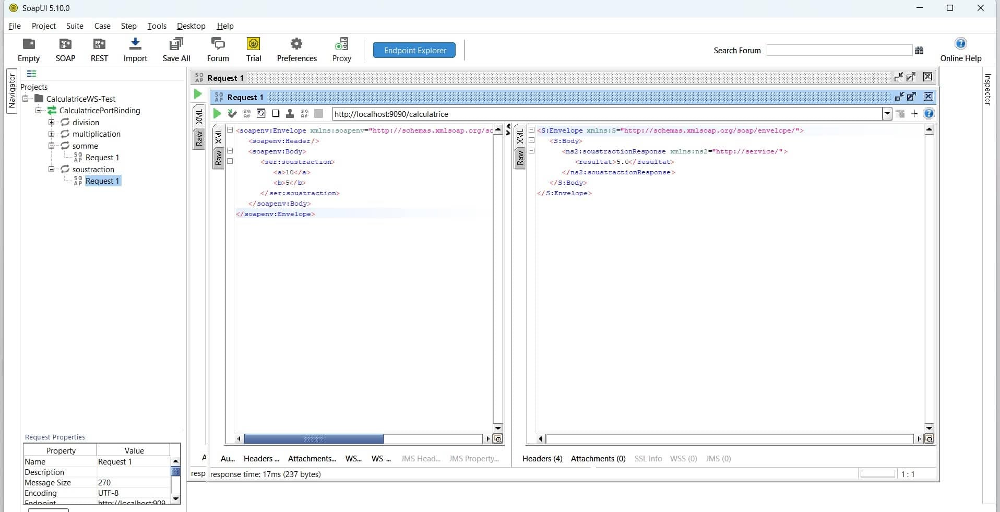

*Opération multiplication*

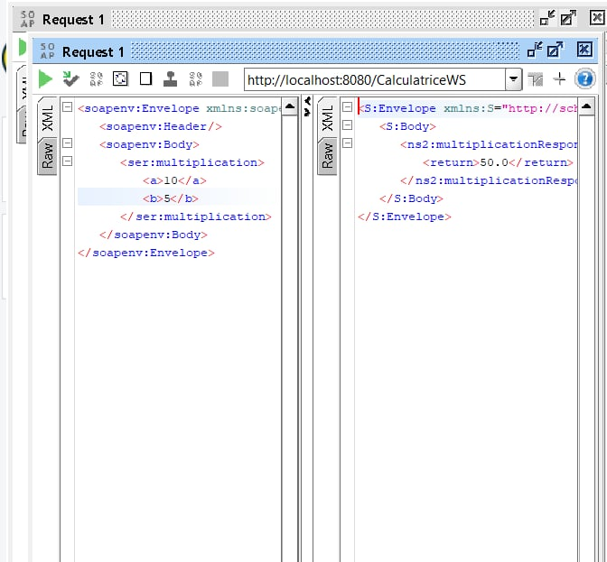

*Opération division*

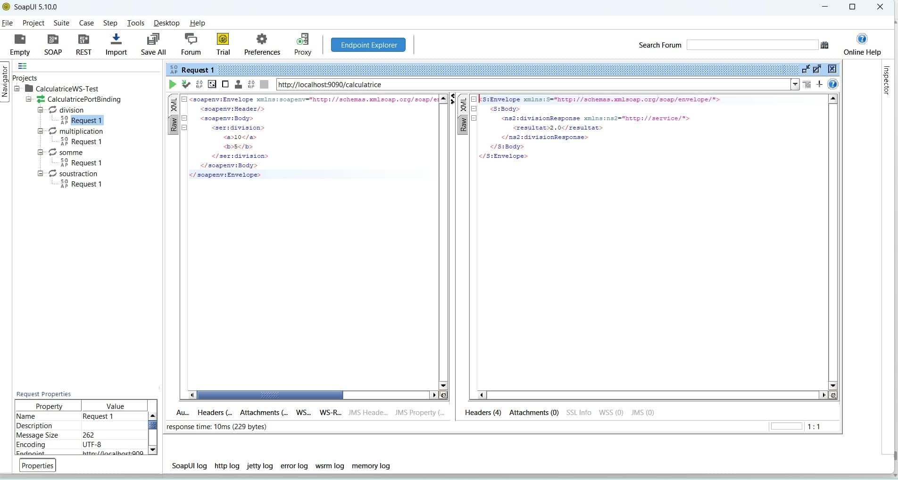

## 12. Auteur

Ahmed Hamdi – LSI3-GLSI – Faculté des Sciences de Sfax – 2026-2027    
localhost